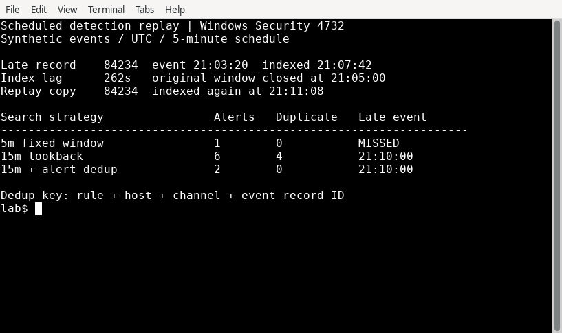
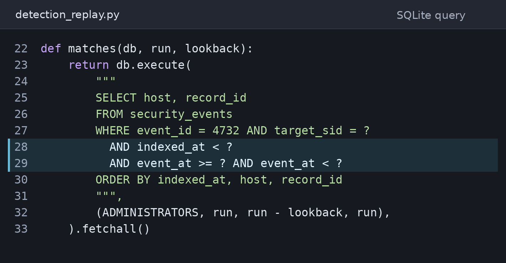

# Detection Replay

[](https://github.com/AhmedAlAbdullah0/detection-replay/actions/workflows/validation.yml)

**Recover late-arriving events. Emit one alert per event.**

A Python and SQLite project examining two practical failure modes in scheduled
security detections: missed events caused by indexing delay, and duplicate alerts
caused by overlapping lookback windows and repeated ingestion.

The detection follows Windows Security event **4732** for additions to the
built-in Administrators group (`S-1-5-32-544`).

## Result

| Search strategy | Alerts emitted | Duplicate alerts | Late event |
|---|---:|---:|---|
| 5-minute fixed window | 1 | 0 | Missed |
| 15-minute lookback | 6 | 4 | Recovered at 21:10 UTC |
| 15-minute lookback + alert deduplication | **2** | **0** | **Recovered at 21:10 UTC** |

The wider window recovers coverage. A unique alert identity prevents repeated
delivery of the same matching record within the replay.



## Run it

Requires Python 3.10+ and its standard library. No external packages or services
are needed for the replay or tests.

```bash
git clone https://github.com/AhmedAlAbdullah0/detection-replay.git
cd detection-replay
python detection_replay.py
python -m unittest -v
python verify.py
```

Use `py` instead of `python` on Windows if that is your configured launcher.
The checked execution used Python 3.12; see [environment.json](environment.json).

## Why the event disappears

Record **84234** occurs at **21:03:20** and is indexed at **21:07:42**: a
**262-second delay**. The scheduled search runs every five minutes.

| Search run | Index availability | 5-minute event-time window | Outcome for 84234 |
|---|---|---|---|
| 21:05:00 | Not indexed yet | [21:00, 21:05) | Cannot match |
| 21:10:00 | Indexed | [21:05, 21:10) | Event time is too old |
| 21:10:00 with 15-minute lookback | Indexed | [20:55, 21:10) | Matches |

The query gates on **both** when the event happened and when it became available.
Ignoring `indexed_at` would incorrectly give an earlier search knowledge of a
record that had not arrived.



## Why the wider window produces six alerts

The two matching identities are `WIN-LAB / Security / 84217` and
`WIN-LAB / Security / 84234`. The input also contains a second ingestion of
84234 at **21:11:08** and an unrelated group-membership record as a negative control.

| Run | Raw matches with 15-minute lookback | New alerts after deduplication |
|---|---:|---:|
| 21:05 | 1 | 1 |
| 21:10 | 2 | 1 |
| 21:15 | 3 | 0 |
| 21:20 | 0 | 0 |
| **Total** | **6** | **2** |

Both overlapping searches and replayed ingestion increase the match count.
The alert table uses this compound primary key:

```sql
PRIMARY KEY (channel, host, record_id, rule)
```

`INSERT OR IGNORE` attempts the insert; an alert is emitted only when the insert
creates a new row. `host` and `channel` scope Windows record IDs, while `rule`
keeps independent detections separate.

## Evidence bundle

| Artifact | Purpose |
|---|---|
| [detection_replay.py](detection_replay.py) | Original replay implementation |
| [replay_output.txt](replay_output.txt) | Output captured by re-running that implementation |
| [results.json](results.json) | Strategy counts, event identities, and emitted-run timestamps |
| [run_results.csv](run_results.csv) | Per-run matches and newly emitted alerts |
| [test_replay.py](test_replay.py) | Behavioral tests for timing, filters, identity, and repeat runs |
| [verification.txt](verification.txt) | Recorded result: **12 tests passed** |
| [verify.py](verify.py) | Regenerates outputs and verifies the reference outcomes |
| [environment.json](environment.json) | Python, SQLite, and platform details for the recorded run |
| [SHA256SUMS.txt](SHA256SUMS.txt) | Integrity hashes for the source, original images, and evidence outputs |

The images show the query and results view; the source and machine-readable
outputs make those results independently reproducible.

## Continuous validation

The [Validation workflow](https://github.com/AhmedAlAbdullah0/detection-replay/actions/workflows/validation.yml)
runs all 12 behavioral tests and reproduces the replay on four configurations:
Python 3.10 and 3.12 on Ubuntu 24.04 and Windows Server 2022.
The [first matrix run](https://github.com/AhmedAlAbdullah0/detection-replay/actions/runs/45141961895)
passed all four jobs for commit `e01c9834a4f7d9e3c4595568f6f73b14240ac1a8`.

## Engineering boundaries

- The four input records are explicitly defined in `EVENTS` for deterministic
  replay. This repository evaluates scheduling behavior; it does not collect
  live Windows telemetry or claim a production incident.
- The SQLite database is in memory. Deduplication state survives the scheduled
  runs **within that replay**, not a new Python process. A deployed detector needs
  durable state and coordinated alert delivery.
- A finite lookback cannot recover unlimited indexing delays. Tune the horizon
  using measured latency, scheduler behavior, and source coverage.
- The key assumes stable, non-null source identifiers. Account for log resets,
  host renaming, identity reuse, and retention when applying it elsewhere.
- The insert and external alert delivery are not one distributed transaction.
  A production sender needs retries or an outbox design to handle delivery failures.
- Event 4732 identifies a membership change. Whether the change is authorized
  requires investigation of the actor, added member, host, and change context.

## References

- [Microsoft: Windows Security event 4732](https://learn.microsoft.com/en-us/previous-versions/windows/it-pro/windows-10/security/threat-protection/auditing/event-4732)
- [Microsoft: well-known SID structures](https://learn.microsoft.com/en-en/openspecs/windows_protocols/ms-dtyp/81d92bba-d22b-4a8c-908a-554ab29148ab)
- [SQLite: ON CONFLICT and IGNORE](https://www.sqlite.org/lang_conflict.html)
